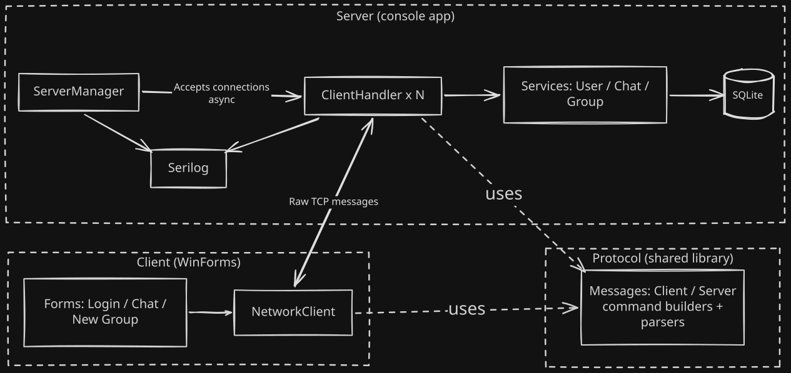

# ChatWithSockets

A multiuser chat system built from scratch on raw TCP sockets — no WebSockets, no SignalR, no third-party chat SDK. Client and Server talk through a custom application-layer protocol defined in a shared library, with async, thread-safe connection handling on the server side.


## Features

- Login / logout with persisted user accounts
- Contact list with real-time online/offline status
- Private (1-to-1) messaging
- Group creation, management, and group messaging
- Real-time typing indicators, for both private and group chats

## Screenshots

<!-- TODO: add screenshots of Login, Chat, and New Group forms -->
<!--  -->
<!--  -->
<!--  -->

  
## Architecture

The solution is split into three projects that make the design explicit: the protocol is not an implementation detail buried inside Server or Client, it's a first-class shared contract.



- **Server** accepts connections asynchronously and spins up one `ClientHandler` per connected client, tracked in a `ConcurrentDictionary`. All broadcast/routing operations (private message, group message, status updates) go through the handler map, so the server stays thread-safe under concurrent clients without locking the whole state.
- **Client** is a WinForms app. `NetworkClient` owns the socket and exposes events (`MessageReceived`, `ServerConnected`, `ServerDisconnected`) that the forms subscribe to — the UI never touches the socket directly.
- **Protocol** is referenced by both Client and Server. It's the only place that knows how a message is built or parsed, so the wire format can't drift between the two sides.

## The protocol

Messages are plain UTF-8 strings, one per line (`\n`-terminated), with fields separated by `;`. The first field is always a command from a shared enum (`Client.Commands` or `Server.Commands`).

```
Client -> Server:  USER_LOGIN;nick;pass
Server -> Client:  OK;USER_LOGIN
```

```
Client -> Server:  CHAT_PRIVATE_MESSAGE;bob;hey, you around?
Server -> Client:  CHAT_PRIVATE_MESSAGE;alice;hey, you around?
```

Every command has a typed builder on the `Protocol` side (`Messages.Client.Chat.Private.SendMessage(...)`, `Messages.Server.Contacts.Online(...)`, etc.), so neither Client nor Server ever hand-assembles a raw string — that's covered by `Protocol.Tests`.

## Tech stack

| Layer | Technology |
|---|---|
| Language / runtime | C# / .NET 9 |
| Transport | Raw TCP sockets (`TcpListener` / `TcpClient`) |
| Client UI | WinForms |
| Persistence | SQLite (`Microsoft.Data.Sqlite`) |
| Logging | Serilog |
| Testing | xUnit |
| CI/CD | GitHub Actions |

## Download

Pre-built, self-contained binaries (no .NET runtime required) are published automatically for every tagged release:

**[github.com/Vini-boat/ChatWithSockets/releases](https://github.com/Vini-boat/ChatWithSockets/releases)**

- **Server**: available for `win-x64` and `linux-x64`
- **Client**: available for `win-x64` (WinForms is Windows-only)

Each platform also ships a framework-dependent build if you already have the matching .NET 9 runtime installed and prefer a smaller download.

To run it:

1. Download and unzip the Server build for your platform, then run the executable to start listening for connections.
2. Download and unzip the Client build, run it, and log in — repeat for as many client instances as you want to chat with.

## Testing & CI/CD

The test suite (`Protocol.Tests`, `Server.Tests`, `Client.Tests`, all xUnit) runs on every push and pull request to `main` via GitHub Actions. Tagged releases (`vX.Y.Z`) trigger a second pipeline that re-runs the tests and, only if they pass, builds and publishes the cross-platform binaries above.

## License

MIT — see [LICENSE](LICENSE).
